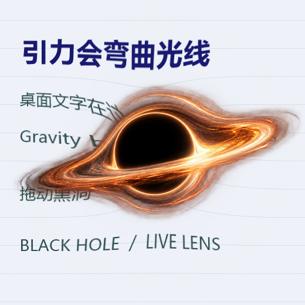

# Desktop Black Hole · 桌面黑洞

一个轻量的 Windows 桌面悬浮黑洞。它实时采集周围的屏幕画面，用径向位移模拟引力透镜，让文字、窗口边缘和桌面线条向黑洞弯曲。



## 下载与运行

下载 [`dist/DesktopBlackHole.exe`](dist/DesktopBlackHole.exe)，双击即可运行。程序是单文件，无须安装。适用于 Windows 10/11；建议使用 Windows 10 版本 2004 或更新版本，以便将悬浮窗口从屏幕采集中排除。

## 操作

| 操作 | 功能 |
| --- | --- |
| 按住黑洞左键拖动 | 改变位置 |
| 在黑洞上滚动鼠标滚轮 | 调整大小 |
| 在黑洞上右键 | 打开控制菜单 |
| Ctrl+Alt+B | 显示或隐藏 |
| 双击托盘图标 | 显示或隐藏 |

菜单提供暂停刷新、三档引力强度、鼠标穿透、重置大小和退出。启用鼠标穿透后，可从托盘图标的右键菜单关闭。

## 从源码构建

需要 Windows 和 .NET Framework 4.x 自带的 C# 编译器。打开 PowerShell，在仓库目录运行：

```powershell
.\build.ps1
```

生成的程序位于 `dist/DesktopBlackHole.exe`。源码为 [`src/BlackHole.cs`](src/BlackHole.cs)，黑洞图像位于 [`assets/BlackHoleArt.png`](assets/BlackHoleArt.png)。图像由 OpenAI 图像生成工具为本项目生成，并随项目一同发布。

## 实现说明

程序使用透明置顶窗口覆盖屏幕的一小块区域。每一帧先采集窗口背后的画面，按黑洞中心的距离重新采样像素，再叠加黑洞图像。Windows 的窗口捕获排除功能用于避免黑洞反复拍到自身；较旧系统上会短暂隐藏窗口以采集背景，可能产生闪烁。画面采集和渲染只针对黑洞附近，不会修改其他应用中的文字或文件。

Windows 捕获排除功能参见 [Microsoft 文档](https://learn.microsoft.com/en-us/windows/win32/api/winuser/nf-winuser-setwindowdisplayaffinity)。

## 许可证

[MIT](LICENSE)。
